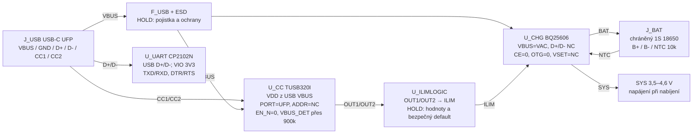
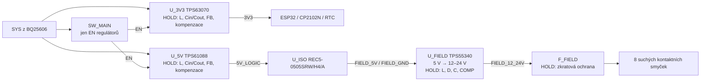
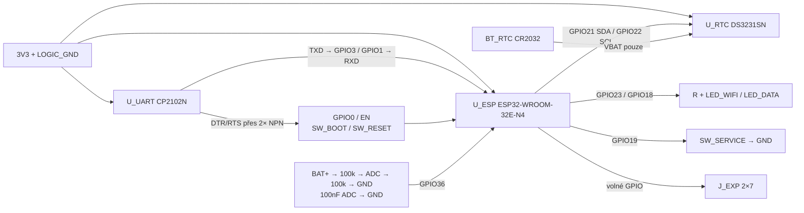

# Elektrické schéma zapojení Rev B — pracovní verze

Stav 2026-10-11: **zapojovací schéma pro převod do KiCadu, nikoli schválené výrobní schéma**. Uvádí všechny funkční cesty, opakovaný vstupní kanál a rozhraní modulů. Piny označené `HOLD` a dosud neurčené pasivy se musí doplnit podle datasheetů před ERC; žádný Gerber se z této verze nesmí vyrábět. `NETS.csv` zachycuje jména sítí, ale není exportovaným CAD netlistem.

## List 1 — USB-C, programování a nabíjení



**Konkrétní zapojení U_CHG:** VBUS pin 24 a VAC pin 1 na jištěný USB_VBUS; BAT piny 13/14 na B+ s 10 µF u IC; SYS piny 15/16 na SYS s nejméně 20 µF u IC; SW piny 19/20 přes L_CHG na SYS; 47 nF mezi BTST 21 a SW; REGN 22 přes 4,7 µF na LOGIC_GND; PMID 23 přes 10 µF na LOGIC_GND; GND 17/18 a tepelný pad na LOGIC_GND. NC 2 a D+ 3 / D− 4 zůstávají nezapojené. CE 9 na LOGIC_GND, OTG 6 na LOGIC_GND, VSET 12 bez odporu pro 4,208 V. ICHG 10 přes odpor `R_ICHG` na LOGIC_GND, ILIM 8 přes volenou odporovou síť na LOGIC_GND, TS 11 do děliče s NTC na článku dle datasheetu. PG 7 / STAT 5 jsou volitelné monitorovací výstupy s pull-upem, bez zapojení nesmějí řídit žádnou nutnou funkci. Hodnoty L_CHG, vstupních kondenzátorů, ICHG, ILIM a TS musí být potvrzeny po výběru článku a USB režimu.

**Zásadní upřesnění:** BQ25606 používá ILIM jen při rozpoznání „unknown“ zdroje; připojení datových pinů jen k CP2102N ponechá BC1.2 detekci nabíječky bez dat. TUSB320I v GPIO režimu detekuje Type-C default / 1,5 / 3 A, ale kombinaci jejích open-drain výstupů s analogovou odporovou sítí ILIM je potřeba doprojektovat a ověřit. Přitom Type-C default na běžném PC portu musí být omezen na příslušný USB proud. Při vypnutém hlavním vypínači musí TUSB320I zůstat napájena z VBUS, aby volba limitu fungovala během nabíjení. Před uzavřením schématu ověřit povolené napětí VDD v celém rozsahu USB VBUS, sekvenci VBUS_DET a přechody mezi režimy. USB D+/D− mají být chráněny ESD a vedeny jako USB pár; nesmějí být spojeny s D+/D− BQ25606.

## List 2 — napájecí větve a izolace



`LOGIC_GND` zahrnuje USB, baterii, SYS, oba primární měniče a ESP32. `FIELD_GND` je pouze sekundár REC5, TPS55340 a LED strany optočlenů. Sítě se nikde nespojí. V5_LOGIC se nespojí s USB_VBUS. Hlavní vypínač ovládá EN primárních měničů, ale **neodpojuje** baterii od U_CHG, aby nabíjení pokračovalo při vypnutém zařízení. EN vyžaduje jednoznačný odporový default a ochranu před zpětným napájením podle zvolených pouzder.

**Izolovaný step-up, předběžný dělič:** FB reference TPS55340 je 1,229 V. `R_TOP=187 kΩ` z výstupu do FB a `R_BOTTOM=10 kΩ + 11 kΩ víceotáčkový trimr` z FB do FIELD_GND dává ideálně asi 24,2 V až 12,2 V. Jezdec trimru spojit s použitým krajním vývodem; přerušení dolní větve tak vytáhne FB nahoru a má omezit spínání, což se musí ověřit prototypem. Hodnoty jsou **návrhové**, nikoli ověřená smyčka regulace. Dále doplnit kompenzaci, soft-start, ochranu proti přepětí, výstupní kondenzátory s dostatečným napětím a ochranu sběrnice FIELD_FUSED před přímým zkratem. Při 8 sepnutých tlačítkách je zatížení přibližně 2 W na 24 V.

## List 3 — ESP32, RTC, USB-UART, diagnostika



ESP EN: 10 kΩ na 3V3 a alespoň 1 µF na LOGIC_GND; RESET spínač jej stahuje k zemi. GPIO0: 10 kΩ na 3V3; BOOT spínač jej stahuje k zemi. DTR/RTS přes dvoutranzistorovou logiku dle Espressif DevKitC V4 tak, aby současná aktivace obou signálů nezablokovala reset. Napájení CP2102N a případné propojení jeho VBUS sense / VREGIN musí být nakresleny podle zvolené varianty čipu; **U_UART není zatím pinově uzavřen**. Každý I²C vodič má jediný 4,7 kΩ pull-up na 3V3. CR2032 není nabíjen. Nevyužité piny jsou uvedeny v `PINOUT.md`; strapping piny na expanzi nesmějí být zatíženy při resetu.

## List 4 — jeden vstupní kanál, opakuje se 8×

```text
FIELD_FUSED ── J_LANE[n].1 ──[ suchý kontakt v kabelu ]── J_LANE[n].2
             ── R_LANE[n] 2k2 / ≥0,5 W ──┬── U_OPTO[n].1 ANODA
                                         └── D_LANE[n] KATODA
FIELD_GND ─────────────────────────────────┬── U_OPTO[n].2 KATODA
                                         └── D_LANE[n] ANODA

3V3 ── R_PULL[n] 10k ──┬── U_OPTO[n].4 KOLEKTOR ── GPIO[n]
                       └── testovací bod podle potřeby
LOGIC_GND ───────────────── U_OPTO[n].3 EMITOR
```

| n | GPIO | n | GPIO |
|---:|---:|---:|---:|
| 1 | 32 | 5 | 27 |
| 2 | 33 | 6 | 14 |
| 3 | 25 | 7 | 34 |
| 4 | 26 | 8 | 35 |

Při zavřeném kontaktu je vstup LOW. Odhad proudu LED: `(12−1,2)/2200 ≈ 4,9 mA` až `(24−1,2)/2200 ≈ 10,4 mA`. Nejvyšší disipace odporu je asi 0,236 W, proto má mít nejméně 0,5W výkonovou rezervu a teplotní test. Polarita EL817-G je podle výrobce 1=anoda, 2=katoda, 3=emitor, 4=kolektor. U třídy C se musí ověřit CTR a logická LOW úroveň při dolní mezi napětí, délce kabelu a teplotě.

## Co je nutné dopracovat do nativního schématu

1. Uzavřít nabíjecí proud podle vybraného chráněného článku, teplotní dělič TS, Type-C proudovou logiku a shodu USB programování/nabíjení v každém režimu. Ověřit, zda zvolený chráněný článek skutečně umožní příslušný proud.
2. Převzít úplná referenční zapojení TPS63070, TPS61088, TPS55340 včetně hodnot L/C/R a kompenzace; spočítat tepelnou a proudovou bilanci. Dělič 12–24 V ověřit na obou koncích rozsahu a při poruše trimru.
3. Zvolit přesné USB-C, svorky, CR2032 držák a tlačítka, zakreslit jejich číslování a všechny pouzdrové piny. Poté teprve převést do KiCadu a spustit ERC.
4. Změnit placement podle `COLLISION_AUDIT.md`, doplnit courtyardy, měděné keep-outy a 3D kontrolu krabičky; po schválení schématu a placementu routovat a spustit DRC.

Primární zdroje: [BQ25606](https://www.ti.com/lit/ds/symlink/bq25606.pdf), [TUSB320I](https://www.ti.com/lit/ds/symlink/tusb320.pdf), [TPS55340](https://www.ti.com/lit/ds/symlink/tps55340.pdf), [Espressif DevKitC V4](https://dl.espressif.com/dl/schematics/esp32_devkitc_v4_sch.pdf), [EL817-G](https://www.everlight.com/wp-content/plugins/ItemRelationship/product_files/pdf/EL817-G.pdf).
